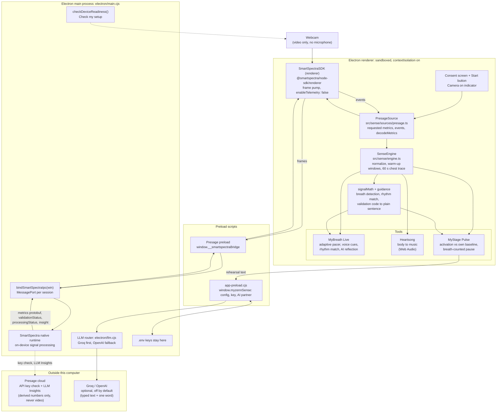

# MyZenn Sense

Three [MyZenn] Sanctuary tools that listen to your body through your camera, powered by the
[Presage SmartSpectra SDK](https://smartspectra.presagetech.com/docs). It's a desktop app (Electron), and every signal is
processed on your computer.

| Tool | What it does | Live Presage signals |
| --- | --- | --- |
| **MyBreath Live** | A breathing guide that starts at *your* measured pace, then slows a step each time your breathing keeps up, towards about 6 breaths a minute. A dotted ring shows your real chest movement against the guide. | Breathing rate, chest breathing trace, pulse, HRV |
| **Heartsong** | An instrument your body plays. Your heartbeat keeps the tempo, each breath adds a note and swells a drone, blinks ring bells, and a smile brightens the key from minor to major. Settling into slow breathing resolves the music. | Pulse, breathing trace, blinking, expressions |
| **MyStage Pulse** | Rehearse a hard conversation (7 scenarios, 3 difficulty levels). When your heart races, your partner pauses so you can take three breaths, counted from your chest movement. Afterwards you see how fast you settled. | Pulse, breathing, expressions, talking, EDA proxy |

> Wellness practice only. It is not a medical device and makes no diagnosis or medical decisions. See [PRIVACY.md](PRIVACY.md).

## How it responds to human signals

### Architecture



Video frames move from the camera through the renderer SDK, over a `MessagePort`, to the native SmartSpectra runtime in the main
process, and never leave the computer. Only derived results come back to the page. Dotted lines are network calls: the SDK's
key check and LLM Insights (while heart signals are on) to Presage, and the optional AI rehearsal partner to Groq or OpenAI.

- **Chest trace, not just rates.** The SDK's breathing rate is a 30-second average. The app also detects individual breaths in the chest trace (`src/sense/signalMath.ts`), so the pacer, Heartsong's melody and MyStage's three-breath pause react within seconds.
- **Rhythm match.** It cross-correlates your chest movement with the guide over small time lags and both polarities, then shows "In rhythm %" (`rhythmMatch`).
- **Adaptive pacer.** `src/tools/breath-live/pacer.ts` holds each step until you have kept up, eases back if you struggle, and never goes below the target.
- **Live guidance.** Every SDK `ValidationCode` maps to a plain sentence such as "A little dark. Face a window or a soft lamp." (`src/sense/guidance.ts`).
- **Honest warm-up.** Readings are shown as "tuning in" until each SDK window fills: pulse 12 s, breathing 30 s, HRV 60 s.
- **Talking detection.** The SDK's `TALKING` signal pauses breathing-based decisions (breathing cannot be measured while you speak): the MyBreath Live pacer holds its step, and MyStage Pulse scores activation from heart rate and expression only.
- **Full HRV set.** RMSSD, SDNN and the Baevsky index, each compared only with your own start, as Presage's HRV model card advises.
- **Device Readiness.** "Check my setup" runs the SDK's `checkDeviceReadiness()` from the main process and shows Presage's verdict and recommended next step before you spend a measurement.
- **Graceful degradation.** If a key is not provisioned for pulse and HRV, the app restarts the session with breathing and face signals only, and says so.
- **Transparent LLM Insights.** While heart signals are on, the SDK auto-sends pulse, HRV and breathing-rate numbers to Presage's LLM Insights. The app does not display these check-ins, but it counts each one received and lets users turn heart signals off.
- **Presage AI reflection.** At the end of MyBreath Live, the app calls `requestInsight()` once with a prompt written to Presage's prompt guidance, matches the reply by request id, and decodes the `Insight` protobuf itself (`src/sense/insight.ts`, since the SDK ships no decoder). The reply is shown only if it passes a wellness-language filter that hides any diagnosis, treatment or condition talk.
- **EDA proxy in MyStage Pulse.** Requests `EDA_TRACE` and scores the rise in skin response above your own settled baseline (arbitrary units, so relative change only) as one input to body activation. If the key is not provisioned for EDA, the session drops just EDA and keeps pulse and HRV.
- **Camera picker.** Lists cameras without turning any on, opens the chosen one with `getUserMedia` and hands the stream to the SDK via `useMediaStream()`. The setup check maps the same camera to the SDK's `availableCameras()` by name.
- **Credit-aware.** Live sessions auto-pause (default 5 min) and the app estimates credits used. A clearly labelled practice mode uses a simulator, so development never spends credits.

SDK integration lives in `electron/main.cjs` (bridge, camera permission) and `src/sense/sources/presage.ts` (requested metrics,
events, decoding).

## Setup

**Requirements:** Windows 10/11 x64, macOS on Apple Silicon, or Linux x64/arm64 (glibc 2.35+), plus Node.js 22.12+ and a webcam.
You also need a free Presage API key from https://physiology.presagetech.com.

```bash
git clone <this repo> myzenn-sense
cd myzenn-sense
npm install                 # also downloads the SmartSpectra native runtime (~350 MB, all platforms)
cp .env.example .env        # then paste your key: PRESAGE_API_KEY=...
npm run app                 # builds and opens the desktop app
```

Other commands:

| Command | Purpose |
| --- | --- |
| `npm run app:dev` | Desktop app with hot reload |
| `npm run dev` | Browser preview in practice mode (simulated signals, no camera) |
| `npm test` | Unit tests (signal maths, pacer, Heartsong mapping, activation detector) |
| `npm run smoke` | Boots the desktop app and checks the SDK wiring without opening the camera or using credits |

Optional AI partner for MyStage Pulse: add `GROQ_API_KEY` (primary) and optionally `OPENAI_API_KEY` (fallback) to `.env`, then
turn on the AI partner in Privacy & settings. Calls go Groq first and fall back to OpenAI only if Groq fails. A retired model
falls through to the next model on the same provider (`electron/llm.cjs`). Without a key, a built-in scripted partner is used.
No login is needed.

**Tips for good readings:** sit still in soft, even light, facing the screen. Keep your face and chest in view, with only one
person in frame.

## Consent and data handling

Camera use requires an explicit consent screen and a Start press, and shows a visible "Camera on" indicator. Frames are processed
on-device and video never leaves the computer. SDK telemetry is switched off. While heart signals are on, the SDK's built-in
LLM Insights send pulse, HRV and breathing-rate numbers to Presage. This is disclosed on the consent screen, counted live in
the app, and avoidable by turning heart signals off. Session history is opt-in (numbers only, local) and deletable. The optional
AI partner sends only typed text and a one-word state, to Groq, or to OpenAI if Groq fails. Full details are in
[PRIVACY.md](PRIVACY.md).

## Credits

Built for the DEV x Presage SmartSpectra SDK Challenge (November 2026) by Rohan Jain. Reused MyZenn assets and code are listed in
[CREDITS.md](CREDITS.md). MyZenn Sense code is MIT-licensed. The Presage SDK is proprietary and installed from npm.
